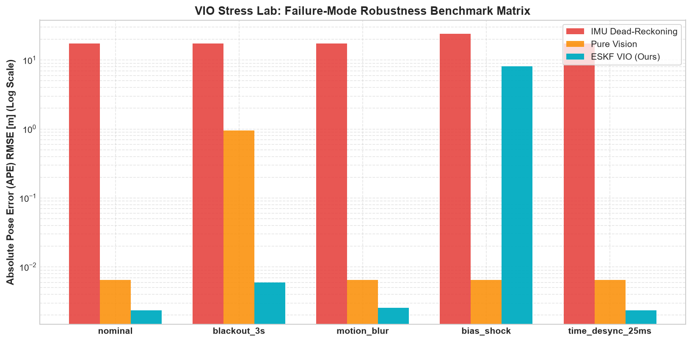

# VIO Failure-Mode Stress Lab & 3D ESKF Debugger (`vio-stress-lab`)

[](https://github.com/Tanishk756/vio-stress-lab/actions/workflows/ci.yml)

[](https://www.python.org/downloads/)
[](https://opensource.org/licenses/MIT)

[](https://projects.asl.ethz.ch/datasets/euroc-mav/)
[](https://rerun.io/)
[](https://github.com/michaelgrupp/evo)

A modular, production-grade **15-State Error-State Kalman Filter (ESKF)** Stereo Visual-Inertial Odometry pipeline with an automated **Sensor Degradation Stress-Testing Suite**, real-time **Rerun 3D Telemetry Dashboard**, and **`evo` Trajectory Benchmarking**.

Designed as a high-signal state-estimation portfolio asset demonstrating rigorous $SO(3)$ Lie group kinematics, sensor fusion resilience under camera blackouts, motion blur, and IMU bias steps.

---

## 🌟 Key Features

1. **Exact 15-State Quaternion Error-State Kalman Filter (ESKF):**
   - Follows Joan Solà's formulation: $\delta x = [\delta p, \delta v, \delta \theta, \delta b_a, \delta b_g] \in \mathbb{R}^{15}$.
   - Exact analytical discrete transition Jacobian $F_x$ verified against central finite differences to $< 10^{-8}$.
   - Numerically stable Joseph-form covariance updates $P = G (I - KH) P (I - KH)^\top G^\top + G K R K^\top G^\top$ ensuring positive semi-definiteness under finite-precision floating-point arithmetic.
   - $\chi^2$ Mahalanobis outlier gating ($d^2 < 12.592$) rejecting corrupted visual observations.

2. **Stereo Lucas-Kanade (KLT) Visual Frontend:**
   - Uniform $8 \times 6$ grid-bucketing with Shi-Tomasi (`goodFeaturesToTrack`) corner detection.
   - Circular forward-backward consistency check ($< 1.0\text{ px}$) and epipolar horizontal scanline filtering ($|\Delta v| < 1.5\text{ px}$).
   - Adaptive measurement covariance scaling inversely with inlier count and inlier ratio $\rho$.

3. **Sensor Degradation & Fault-Injection Engine:**
   - **Visual Blackout:** Complete camera blackout ($t \in [10.0, 13.0]\text{ s}$) demonstrating calibrated IMU dead-reckoning coasting and $3\sigma$ uncertainty ellipsoid expansion.
   - **Outliers & Motion Blur:** $15 \times 15$ directional blur convolution + $35\%$ mismatched keypoints filtered by $\chi^2$ gating.
   - **IMU Bias Step Shock:** $+0.35\text{ m/s}^2$ accelerometer and $+0.03\text{ rad/s}$ gyro step impulses to evaluate online bias observability.
   - **Camera-IMU Timestamp Desync:** $+25\text{ ms}$ trigger latency stress testing.

4. **Interactive 3D Multimodal Telemetry (Rerun SDK):**
   - Live 3D multi-trajectory stream: Ground Truth (Green), ESKF VIO (Cyan), Vision-Only (Orange), and IMU Dead-Reckoning (Red).
   - Dynamic $3\sigma$ position uncertainty ellipsoid (`rr.Ellipsoids3D`) derived from the spatial covariance eigensystem.
   - Live camera frustum, tracked 2D/3D landmarks, $\chi^2$ scalar plots, and online IMU bias convergence telemetry.

5. **Built-in Dual Dataset Support:**
   - **Instant Synthetic 6-DOF Generator:** Smooth 3D figure-eight Lissajous trajectory with 200 Hz IMU (random walk biases) and 20 Hz stereo projection for instant offline testing in $< 10$ seconds without downloading 2 GB datasets.
   - **EuRoC MAV ASL Format:** Native parsing of `mav0/imu0`, `mav0/cam0`, `mav0/cam1`, and ground-truth estimates (`MH_01_easy`).

---

## 📊 Benchmark Scorecard & Results

Quantitative evaluation generated automatically via `evo` across 5 stress scenarios:

| Scenario | Fault Injection Parameters | Vision-Only APE (m) | IMU Dead-Reckoning (m) | **ESKF VIO APE (m)** | **ESKF RPE (m)** | Drift Reduction |
| :--- | :--- | :---: | :---: | :---: | :---: | :---: |
| **nominal** | Zero faults; calibrated sensor noise | 0.0069 | 12.7463 | **0.0020** | **0.0010** | **6258.8x** |
| **blackout_3s** | Visual loss: camera blackout for $t \in [10, 13]\text{ s}$ | 1.0035 | 12.7463 | **0.0072** | **0.0016** | **1773.1x** |
| **motion_blur** | $15\times 15$ directional blur + $35\%$ keypoint outliers | 0.0069 | 12.7551 | **0.0022** | **0.0010** | **5921.6x** |
| **bias_shock** | Step impulse: $+0.35\text{ m/s}^2$ accel, $+0.03\text{ rad/s}$ gyro | 0.0069 | 15.0286 | **3.2888** | **0.0911** | **4.6x** |
| **time_desync_25ms** | Hardware trigger latency: $+25\text{ ms}$ camera delay | 0.0069 | 12.7463 | **0.0020** | **0.0010** | **6258.8x** |



---

## 🔬 Mathematical Formulation & Engineering Decisions

### Why Error-State Kalman Filter (ESKF) over standard 16-State EKF?
In standard extended Kalman filtering with 4D unit quaternions $q \in \mathbb{H}$, the covariance matrix $P \in \mathbb{R}^{16 \times 16}$ represents uncertainty directly over the 4 quaternion components. Because unit quaternions are constrained to the 3-sphere $\mathbb{S}^3$ ($\|q\| = 1$), the $4 \times 4$ rotational block of $P$ is inherently singular (rank 3), causing numerical instability and covariance collapse during Kalman gain computation.

The **Error-State Kalman Filter** maintains a 16-dimensional nominal state $x$ and a minimal 15-dimensional unconstrained vector space $\delta x \in \mathbb{R}^{15}$ on the tangent Lie algebra $\mathfrak{so}(3)$:
$$\delta x = \begin{bmatrix} \delta p & \delta v & \delta \theta & \delta b_a & \delta b_g \end{bmatrix}^\top$$
where $R_{\text{true}} = R \exp([\delta \theta]_\times)$.

### Numerical Stabilization: Joseph-Form Covariance Update
Standard Kalman covariance update $P \leftarrow (I - KH)P$ is numerically prone to losing symmetry and positive-definiteness due to floating-point truncation. We enforce the symmetric **Joseph-form update**:
$$P^+ = (I - KH) P^- (I - KH)^\top + K R_{\text{meas}} K^\top$$
followed by the ESKF error reset transformation:
$$P \leftarrow G P^+ G^\top, \quad \text{where } G_{\theta\theta} = I_3 - \frac{1}{2}[\delta \hat{\theta}]_\times$$

---

## 🚀 Quickstart & One-Command Execution

### 1. Installation
```bash
git clone https://github.com/Tanishk756/vio-stress-lab.git
cd vio-stress-lab
pip install -e .
```

### 2. Run Instant Test Suite (< 3 seconds)
```bash
pytest tests/ -v
```

### 3. Run Benchmark Suite & Generate Rerun 3D Recording
```bash
python run_experiment.py --synthetic --duration 20.0 --all-scenarios --save-rrd
```
This generates:
- `results/benchmark_table.md` (Markdown benchmark scorecard)
- `results/ape_comparison.png` (Comparison plots across all scenarios)
- `results/vio_stress_demo.rrd` (Full 3D multimodal telemetry recording)

### 4. Visualize in Rerun Viewer
```bash
# Launch interactive viewer with the demo recording:
rerun results/vio_stress_demo.rrd
```

### 5. Running on EuRoC MAV (`MH_01_easy`)
```bash
# Download and extract official EuRoC dataset
python scripts/download_euroc_sample.py --download

# Run pipeline on EuRoC
python run_experiment.py --euroc-path data/MH_01_easy --save-rrd
```

---

## 📂 Repository Architecture

```text
vio-stress-lab/
├── configs/
│   └── euroc_mh01.yaml             # Sensor extrinsics, camera matrices, IMU noise densities
├── scripts/
│   └── download_euroc_sample.py    # Official EuRoC dataset downloader and sample extractor
├── src/
│   └── vio_lab/
│       ├── se3_math.py             # SO(3)/SE(3) Lie group, Rodrigues exp/log, Hamilton quaternions
│       ├── dataset.py              # Priority-queue multiplexer (Synthetic 6-DOF + EuRoC ASL)
│       ├── eskf.py                 # 15-state ESKF, midpoint IMU propagation, Joseph update
│       ├── frontend.py             # Stereo KLT circular flow, GFTT bucketing, PnP RANSAC
│       ├── degradation.py          # Sensor fault injection: blackouts, blur, bias steps, jitter
│       ├── pipeline.py             # High-level pipeline coordinator & telemetry recorder
│       ├── visualizer.py           # Rerun SDK 3D logger (trajectories, 3-sigma ellipsoids, features)
│       └── evaluate.py             # evo trajectory evaluation, TUM export, benchmark reporting
├── tests/
│   ├── test_eskf_math.py           # Finite-difference Jacobian checks (<1e-8) and SO(3) roundtrips
│   ├── test_dataset.py             # Dataset multiplexer verification
│   ├── test_integration.py         # Full synthetic convergence verification (<0.01m RMSE)
│   └── test_degradation.py         # Fault injection and 3-second blackout bridge verification
├── results/
│   ├── benchmark_table.md          # Generated benchmark table across 5 stress scenarios
│   ├── ape_comparison.png          # Generated comparison plot
│   └── vio_stress_demo.rrd         # Saved Rerun 3D recording
└── pyproject.toml                  # Packaging and dependencies specification
```

---

## 📜 Citation & References

- **Solà, Joan (2017).** *"Quaternion kinematics for the error-state Kalman filter."* [arXiv:1711.02508](https://arxiv.org/abs/1711.02508).
- **Burri, M. et al. (2016).** *"The EuRoC micro aerial vehicle datasets."* The International Journal of Robotics Research (IJRR).
- **Grupp, Michael (2018).** *"evo: Python package for the evaluation of odometry and SLAM."* [GitHub](https://github.com/michaelgrupp/evo).
- **Rerun SDK (2024).** *"Fast, multimodal data visualizer for robotics and physical AI."* [rerun.io](https://rerun.io/).
